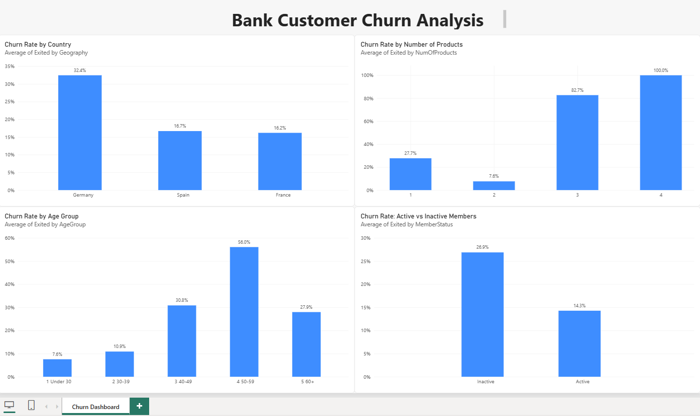

# Bank Customer Churn Analysis (SQL + Power BI)

## Overview
This project analyzes why bank customers leave (churn). I used SQL Server to explore the data and Power BI to visualize the results. About 1 in 5 customers in this dataset left the bank, so I looked for patterns that could help a bank spot at-risk customers early.

**Question:** Which customers are most likely to leave the bank?

## Dataset
- Source: Kaggle, "Bank Customer Churn" dataset
- 10,000 customers across France, Germany, and Spain
- Fields include age, country, balance, number of products, active-member status, and whether the customer left (`Exited`)

## Tools Used
- SQL Server (SSMS) for data checks and analysis
- Power BI Desktop for the dashboard
- Git/GitHub for version control

## Dashboard

## Data Quality Checks
Before the analysis I checked for duplicate customers and missing values.

## Key Findings
1. **Germany has the highest churn.** German customers churn at 32.4%, about double Spain (16.7%) and France (16.2%).
2. **Age is a strong driver.** Customers aged 50-59 churn at 56.0%, compared with under 11% for customers under 40.
3. **Number of products matters.** Customers with 2 products are the most loyal (7.6% churn). Customers with 3 or 4 products churn at 82.7% and 100%, though these groups are small (326 customers combined).
4. **Inactive members leave more.** Inactive members churn at 26.9% versus 14.3% for active members. Inactivity is an early warning sign a bank could act on.
5. **Country and age combined.** Customers aged 40+ churn at roughly 3-4x the rate of younger customers in every country, but Germany is higher in both age bands. German customers aged 40+ are the highest-risk segment at 50.8%.

## Data Note
Customers who filed a complaint churned at 99.5%, versus 0.1% for those who did not. This near-perfect match suggests the complaint is recorded when the customer leaves, so I did not treat it as a predictor of churn.

## Limitations
- These results show patterns, not causes. For example, I can't say that extra products make customers leave.
- Some groups are small (3-4 products), so those rates should be read with caution.

## Possible Recommendations
- Focus retention efforts on customers aged 40+, especially in Germany.
- Re-engage inactive members before they leave.
- Review why customers with 3 or more products leave so often.

## Files
- `churn_analysis.sql`: all SQL queries used in the analysis
- `Bank-Churn-Dashboard.pbix`: Power BI dashboard
- `dashboard.png`: dashboard screenshot
